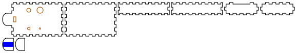
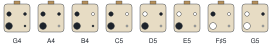
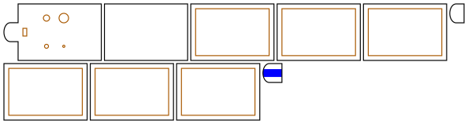

# Box ocarina

<!-- readme-only -->
**[Read the writeup](https://gernreich.github.io/box-ocarina/)** ·
**[Turn both builds in 3D](https://gernreich.github.io/box-ocarina/#turn-it-in-3d)**

<!-- page-only **[Read the README](https://github.com/Gernreich/box-ocarina)** -->

A four-hole ocarina in G4, in 3mm plywood: a rectangular box with a beak to blow
into, four finger holes in its top, and the English fingering, which gets a whole
octave out of four holes. All closed it sounds G4; the fingerings below give the
G major scale up to G5, and five more notes besides.

Output is millimetre-true — `1 user unit = 1mm` with a physical `width`/`height` — so
it prints and cuts at real size.

**Neither build has been cut or played yet.** The cavity and the holes come from an
acoustic model whose window term is not measured, and the first one cut will set it.
[Before you cut](#before-you-cut) says what that means for the first build.

<table>
<tr>
<td align="center"><a href="cut-files/box/box-ocarina-G4-box-sheet1-cut-files.svg"></a></td>
</tr>
<tr>
<td align="center"><sub>box · the whole ocarina on one 579 × 104mm sheet</sub></td>
</tr>
</table>

Built for **[LaserMadeMusic](https://www.youtube.com/@LaserMadeMusic)**.

**[The rest of the build files](https://gernreich.github.io/)** — every instrument,
generator and tool, indexed.

**[Download everything as a ZIP](https://github.com/Gernreich/box-ocarina/archive/refs/heads/main.zip)**

## The builds

Two ways to build the same ocarina. The cavity, the window and the four holes are
identical; only the walls round the cavity differ.

| Build | Construction | Cavity | Body | Parts | Sheets | Joints |
|---|---|---|---|---|---|---|
| `box` | finger-jointed on all twelve edges | 60 × 18 × 93.6mm | 99.6 × 66.0 × 24mm | 9 | 1 | the bird's layers glued, the rest press-fit |
| `stack` | laminated stack | 60 × 18 × 93.6mm | 105.6 × 72.0 × 24mm | 11 | 1 | every layer and the bird glued |

The body is length × width × depth; the beak runs 18mm past it at the mouth end, and
the bird stands 9mm on the top over the beak.

- **The box** is six plates finger-jointed on all twelve edges, every finger flush to
  the outside faces. Each edge carries as many fingers as fit at the square flute's
  6mm: 15 cells along the box, 9 across it and 3 up each corner, alternating between
  the two plates that meet there. The corner cubes belong to the side walls. The one
  gap in the pattern is under the beak: the mouth-end wall sends no fingers up into
  the top there, so the beak runs on from solid ply and the duct crosses no seam.
- **The stack** is a bottom layer, six frame layers with the cavity cut out of them,
  and the top, all glued.

Neither has anything to slide, so both are tuned at the window and the holes. The box
had a press-fit end plug to tune with until it was jointed on every edge.

Both carry the same mouthpiece: the top plate runs on past the body as a beak 24mm
wide, and three bird layers are glued over it. The duct is a fill engrave in the
underside of the bottom bird layer, 10mm wide and about 1mm deep, from the beak's tip
to the window.

## Turn it in 3D

<!-- readme-only -->
Both builds turn in 3D on the [published page](https://gernreich.github.io/box-ocarina/#turn-it-in-3d),
which GitHub does not run: drag to turn it, pull it apart into its parts, or see
through the walls into the cavity.

<!-- page-only <div id="turn3d"></div><script src="viewer.js"></script> -->

## Fingering

Black is covered, white is open. The chart shows the holes as your hands meet them:
beak up, left hand on the left, index fingers on the row nearer the beak.



Hold it with the holes facing away from you and your lips on the beak, thumbs on the
bottom. Each hole is named for the finger that covers it: `L1` is the left index,
`L2` the left middle, `R1` the right index, `R2` the right middle.

| Note | Open | Model | From equal temperament |
|---|---|---|---|
| G4 | none | 392.0Hz | 0 |
| A4 | R2 | 436.9Hz | −12.3c |
| B4 | R1 | 490.4Hz | −12.3c |
| C5 | R2 R1 | 527.0Hz | +12.3c |
| D5 | R2 L1 | 588.3Hz | +2.8c |
| E5 | R2 R1 L1 | 658.0Hz | −3.4c |
| F♯5 | R2 R1 L2 | 735.8Hz | −9.8c |
| G5 | R2 L1 L2 | 780.9Hz | −6.9c |

The other eight fingerings are not in the scale, and three of them are close enough to
use. With every hole open it sounds G♯5, a semitone over the octave.

| Open | Model | Nearest | |
|---|---|---|---|
| L1 | 555.8Hz | C♯5 | +4.3c |
| R1 L1 | 629.0Hz | D♯5 | +18.8c |
| L2 | 646.1Hz | E5 | −35.0c |
| R2 L2 | 674.2Hz | E5 | +38.9c |
| R1 L2 | 710.1Hz | F5 | +28.6c |
| L1 L2 | 756.7Hz | F♯5 | +38.6c |
| R1 L1 L2 | 812.0Hz | G♯5 | −39.1c |
| all four | 834.6Hz | G♯5 | +8.4c |

## What the model says

**An ocarina is a vessel, not a tube.** Its cavity is about 100mm across and the
wavelength at G4 is 880mm, so the air inside acts as one spring and the air in each
opening as a mass on it: a Helmholtz resonator. The pitch depends on the cavity's
volume and on how much air each opening lets through, its conductance, and **not at
all on where a hole is**. That is why the holes sit wherever the fingers fall.

Each opening's conductance is its area over its effective length: the 3mm plate it
goes through, plus Rayleigh's end correction for a flanged end, once inside and once
out. Open holes add to the window's in parallel, so every note asks for a sum:

| Hole | Finger | Conductance | Diameter |
|---|---|---|---|
| `R2` | right middle | 0.242 × the window's | 2.95mm |
| `R1` | right index | 0.565 × | 5.23mm |
| `L1` | left index | 1.010 × | 8.04mm |
| `L2` | left middle | 1.716 × | 12.23mm |

The window is 10 × 5mm, with a conductance of 5.12mm. G4 from that window asks for a
cavity of 101.0cm³, which is the 60 × 18 × 93.6mm both builds have.

**No four holes play a perfect scale.** Two holes opened together always add their
conductances, and the scale's steps do not add that way. Here C5 opens the A4 hole and
the B4 hole together, and the two give more than C5 wants. So the model shares the
error out: A4 and B4 sit 12.3 cents flat and C5 12.3 sharp, and nothing else is out by
more than 10. Of the 53 fingering patterns `ocarina_model.py --search` finds, none
does better than 12.3 cents. Breath bends an ocarina by more than that: blow a little
harder for A4 and B4, a little softer for C5.

**The fingering is found, not copied.** John Taylor's English system of 1964 is the
standard four-hole fingering, and no published source found for this gives its hole
sizes. So the pattern here is the tightest one a search over all four conductances
found, and of those, the one with the fewest finger changes up the scale. It may not
match a commercial English pendant's chart note for note.

## Before you cut

**The window's end correction is not measured.** The jet blowing across the window
lengthens it, by an amount found only in simulation so far: a 2009 simulation of an
ocarina ([Kobayashi and others](https://arxiv.org/abs/0911.3567)) put it well above
the textbook figure. It is the one term every other number rests on: the cavity is
sized to the window, and every hole is sized against it. With every hole closed,
blow the cut ocarina and read its pitch. Then

```sh
python3 ocarina_model.py --heard=380   # the pitch you heard, in Hz
```

prints the `--mouth` that explains it, and the command to redraw both builds with
it. A first build that sounds 50 cents flat is not a failure; it is the measurement.

**The holes can only go up.** A hole that plays flat can be opened with a file. A hole
that plays sharp cannot be closed up, so file in small steps.

**File the splitting edge by hand.** The window's far edge, the one away from the
beak, is where the air splits, and it needs a clean bevel of about 30° that a laser
cannot cut. File it on the outside face, the face the bird sits on, while the top is
still a flat plate on the bench.

**The duct is a fill engrave**, about 1mm deep and the window's 10mm width. The depth
is a power setting, so find it on scrap first.

**The smallest hole is 2.95mm.** It is right for the note, but at the kerf it is the
one most likely to come out ragged or choked with char. Clear it with a 3mm drill
held in the fingers.

**Cut it in 3mm Baltic birch plywood**, at a 0.13mm kerf. The fingers are the square
flute's size or a little over: each edge is split into equal cells, 6.24mm along the
box, 6.67mm across it and 6.00mm up the corners, with no play, so the fit comes from
the kerf compensation alone. Glue the bird's layers together and to the top, and
every layer of the stack. Press-fit
the box, then seal every seam with shellac, inside where you can reach and outside
everywhere: a Helmholtz resonator leaks its note out of any gap.

Run the colours **blue, orange, black**: blue engraves the duct, orange cuts the
window and the holes (and the stack's cavity), and black frees the parts. The parts
are not numbered: the 3D view shows where each one goes.

## Tuning

1. File the splitting edge, then glue the bird on, its end flush with the window's
   near edge so the duct opens straight on to it.
2. Press the box together, or glue up the stack.
3. With every hole closed, play G4. If it is out by more than breath will bend, run
   `--heard` and note the `--mouth` for the next cut.
4. Open each hole alone, smallest first, and file it up to the model's pitch for
   it: `R2` alone 436.9Hz, `R1` 490.4Hz, `L1` 555.8Hz and `L2` 646.1Hz. The
   scale's other notes are sums of these four and follow from them.
5. Seal with shellac once it plays in tune.

## Regenerating it

```sh
python3 ocarina_model.py                       # the design and all sixteen fingerings
python3 ocarina_model.py --mouth=1.2           # with a different window correction
python3 ocarina_model.py --heard=380           # the correction a cut ocarina implies
python3 ocarina_model.py --search              # the fingering patterns, ranked
python3 box_ocarina.py --no-write              # the generator's checks, writing nothing
python3 box_ocarina.py --out=cut-files         # both builds
python3 page_assets.py                         # viewer.js, turn.html and the two plans
```

`ocarina_model.py` is the Helmholtz model above. For a fingering pattern it finds the
four conductances by a pattern search that minimises the worst note's error in cents.
`--search` asks which pattern, from 400 random starts: it found 53 that give eight
different fingerings, and the one used here heads the list, at 12.3 cents and 11
finger moves up the scale.

`box_ocarina.py` builds both from what the model asks for and checks them before
writing anything:

- the model holds the scale within 12.5 cents
- the cavity is the volume the model asks for
- every hole speaks and a finger covers it: from 2.5 to 13mm across
- every hole opens into the cavity, clear of its walls and the window
- ply left between neighbouring holes
- the window opens into the cavity at its mouth-end wall
- the duct runs from the beak's tip to the window
- in the box, every edge is finger-jointed with as many 6mm cells as fit, and the
  six plates fill every cell of all twelve edges and all eight corners exactly once:
  337 points sampled, each found in one plate
- every sheet fits the bed, and every part is on a sheet

It borrows the finger size, the plate class and the sheet packer from
[`square_flute.py`](https://github.com/Gernreich/square-flute/blob/main/square_flute.py),
and the SVG path writer from
[`ribbon_bore.py`](https://github.com/Gernreich/swept-curve/blob/main/ribbon_bore.py)
in swept-curve, so it expects both repositories cloned beside this one.

`.repro` holds the exact command for every generated file here.

The top plate, from outside and to scale, beak on the left:


## Every cut sheet

Each picture is a display rendering; click it for the cut file.

**`box`** · finger-jointed on all twelve edges, cavity 60 × 18 × 93.6mm · 9 parts on 1 sheet

[](cut-files/box/box-ocarina-G4-box-sheet1-cut-files.svg)

**`stack`** · laminated stack, cavity 60 × 18 × 93.6mm · 11 parts on 1 sheet

[](cut-files/stack/box-ocarina-G4-stack-sheet1-cut-files.svg)
