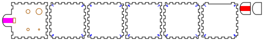
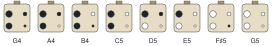

# Four-hole ocarinas

<!-- readme-only -->
**[Read the writeup](https://gernreich.github.io/four-hole-ocarinas/)** ·
**[Turn all five builds in 3D](https://gernreich.github.io/four-hole-ocarinas/#turn-it-in-3d)**

<!-- page-only **[Read the README](https://github.com/Gernreich/four-hole-ocarinas)** -->

Four-hole ocarinas in 3mm plywood, each a solid finger-jointed on every edge at
whatever angle its faces meet: a cube, a uniform octagonal prism, a square antiprism,
a regular octahedron and a regular dodecahedron. Each has a beak to blow into, a
window, four finger holes and the English fingering, which gets a whole octave out
of four holes.

The cube is sized to the model: all closed it sounds G4, and the fingerings below
give the G major scale up to G5, and three of the five notes between that the scale
leaves out. The other four take the same window, holes and fingering, so every
interval is the same; only their cavities differ, and with them the key.

Output is millimetre-true — `1 user unit = 1mm` with a physical `width`/`height` — so
it prints and cuts at real size.

**No build has been cut or played yet.** The cavity and the holes come from an
acoustic model whose window term is not measured, and the first one cut will set it.
[Before you cut](#before-you-cut) says what that means for the first build.

<table>
<tr>
<td align="center"><a href="cut-files/cube/four-hole-ocarina-cube-sheet1-cut-files.svg"></a></td>
</tr>
<tr>
<td align="center"><sub>cube · the whole G4 ocarina on one 454 × 70mm sheet</sub></td>
</tr>
</table>

Built for **[LaserMadeMusic](https://www.youtube.com/@LaserMadeMusic)**.

**[The rest of the build files](https://gernreich.github.io/)** — every instrument,
generator and tool, indexed.

**[Download everything as a ZIP](https://github.com/Gernreich/four-hole-ocarinas/archive/refs/heads/main.zip)**

## The builds

Five builds, every one a solid: the cube is sized to sound G4, and the other four
play in whatever key their shape holds.

| Build | Construction | Cavity | Key, all closed | Body | Parts | Sheets |
|---|---|---|---|---|---|---|
| `cube` | cube, finger-jointed on all 12 edges | 155cm³ | G4, 392.0Hz | 59.7 × 59.7 × 59.7mm | 8 | 1 |
| `octagon` | uniform octagonal prism, finger-jointed on all 24 edges | 354cm³ | C4 −16 cents, 259.3Hz | 110 × 110 × 45.6mm | 12 | 1 |
| `square-antiprism` | square antiprism, finger-jointed on all 16 edges | 279cm³ | D4 −7 cents, 292.4Hz | 101.8 × 101.8 × 60.5mm | 12 | 1 |
| `octahedron` | regular octahedron, finger-jointed on all 12 edges | 127cm³ | A4 −30 cents, 432.5Hz | 83.1 × 72.0 × 58.8mm | 10 | 1 |
| `dodecahedron` | regular dodecahedron, finger-jointed on all 30 edges | 283cm³ | D4 −21 cents, 290.1Hz | 99.1 × 94.2 × 80.2mm | 14 | 1 |

The bird and the chin layer are glued, and the rest is press-fit.

The body is length × width × height, the octagon's across its flats; the beak runs 18mm
past it at the mouth end, the bird stands 3mm on the top over it, and the chin layer
hangs 3mm under it.

- **The cube** is six 59.7mm squares, eight or nine fingers to an edge, sized so that
  its cavity, 53.7mm on a side, holds the 155cm³ that G4 asks for. The top and
  bottom own the corners, and the window and the four holes are on the top. Under
  the beak the face below sends no fingers up into the top, so the beak runs on from
  solid ply and the duct crosses no seam; every build does the same. Until
  2026-10-18 the G4 build was a long box, 60 × 18mm inside and as long as the volume
  needed, finger-jointed or glued up as a laminated stack. At the 14 × 7mm window
  it ran 144mm, 157mm corner to corner inside against a quarter wavelength of 221mm,
  close enough that it would start to act like a tube; the cube is 93mm corner to
  corner. So the box became a cube and the stack went, and every build is a regular
  or uniform solid.
- **The octagon** is a uniform octagonal prism, 110mm across the flats and as tall
  as a wall is wide, 45.6mm: two regular octagons, top and bottom, and eight 45.6mm
  squares. It was 36mm tall until 2026-10-18, a prism but not a uniform one. It holds
  the most air, so it plays lowest, C4. The walls meet each other at 135 degrees
  with six fingers to an edge, and the top and bottom at 90 with seven; the top and
  bottom own the corners. The holes and the window are in the top, the beak runs out
  from the middle of one wall's top edge, and that wall sends no fingers up into the
  top, as on the cube.
- **The square antiprism** is two 72mm squares, top and bottom, a quarter turn apart,
  and eight equilateral triangles between them, 60.5mm tall. Squares meet triangles
  at 103.8 degrees with eleven fingers to an edge, and triangles meet each other at
  127.5 with twelve. The window and the holes are on the top square, on the cube's
  grid. The triangle under the beak slopes away beneath it, so it stops 3.1mm short
  of the top there, clear of the beak's underside, and the chin layer is cut 1.5mm
  shorter to clear the slope.
- **The octahedron** stands on one of its eight equilateral triangles, every edge
  72mm, every joint at 109.5 degrees with eleven or twelve fingers. Its top triangle
  is too small for four holes and the window, so it carries only the window, and
  each hand has a triangle of its own: the two that slope away from the top on
  either side, with the index finger's hole nearer the beak and both holes placed as
  far from the triangle's walls and from each other as they will go. The triangle
  under the beak stops 3.2mm short there, and the chin layer is 2.1mm shorter. It
  holds the least air, less than the cube, so it plays highest, A4 −30 cents, a
  fifth over the antiprism and the dodecahedron.
- **The dodecahedron** stands on one of its twelve regular pentagons, every edge
  36mm, every joint at 116.6 degrees with five or six fingers. The top pentagon
  carries the window, and each hole has a pentagon of its own, where it is furthest
  from that pentagon's walls: the index fingers on the two either side of the
  mouth's pentagon, the middle fingers on the next two round. The pentagon under the
  beak stops 3.4mm short there, and the chin layer is 3.0mm shorter.

**How the solids' fingers go together.** Where two plates meet at an angle wider
than 90 degrees, a plate's finger reaches the outside edge, and in its neighbour's
finger it stops short by 3mm × sin of the angle: 2.12mm at 135 degrees, 2.83mm at
109.5. That is the least that keeps the two plates out of each other, and it leaves
the joint closed along a line, with a shallow V-shaped notch outside each finger and
a small void at each corner. The shellac fills both.

**Where four plates meet.** At a corner of the square antiprism or the octahedron,
two of the four plates share only the corner, and no edge, and run into each other
just inside it. So every plate's corners there are cut off square to the corner's
bisector: 4.25mm in from the corner on the antiprism and 4.75mm on the octahedron,
where the least that clears, found by scanning the corners in 3D, was 3.75 and
4.25mm. That leaves **a hole at every such corner**, open on the outside up to about
6mm in from the point. Shellac will not bridge it: fill each with glue or wood
filler before sealing. On the octagon, the cube and the dodecahedron, where three
plates meet and every pair shares an edge, the corners close on the outside.

The triangles of the antiprism and the octahedron, and the dodecahedron's pentagons,
look alike but are not: each has its own pattern of fingers, set by which corners
are whose, so each goes in one place only. **Every corner of a solid has a number,
and every plate carries it near each of its own corners**: three numbers on a
triangle, four on a square, five on a pentagon. The plates that meet at a corner
all show its number, so the solid goes together by matching them. The 3D view
labels every plate's corners with them (the Corner numbers box turns them off);
pulled apart, it shows each plate with its own. The top plate is the one plate left
unnumbered: it carries half the duct on its outside face, so it is drawn outside
face up, and the beak, the window and the holes already place it. Every corner it
touches is numbered on the plates that meet it there. The corners are numbered from the top down,
1 at the top plate's corner beside the beak on the right hand's side. Each number is
engraved in single lines on the plate's inside face, where the finished ocarina hides it,
4mm tall, its top toward its corner, and set in until it clears the joints, the
holes and the window by 1mm.

**Against Boxes' polyhedra.** [Boxes](https://github.com/florianfesti/boxes) has
a Platonic generator, in its Unstable group, for the tetrahedron, cube, octahedron,
dodecahedron and icosahedron. It cuts every face the same, with one finger edge on
every side, its fingers shifted off-centre so that an edge mates with a copy of
itself turned end for end, and every finger a full plate thickness deep, as at 90
degrees, whatever angle the faces meet at. Here each edge is cut for its own angle,
each corner is given to one plate, and so the plates differ; in exchange the
fingers step back 3mm × sin of the angle, the joints close on the outside, and the
corners are checked in 3D. Boxes does not make the octagonal prism or the
antiprism.

None of the builds has anything to slide, so all are tuned at the window and the holes.

All five carry the same mouthpiece: the top plate runs on past the body as a beak 24mm
wide. One layer, the bird, is glued over it and one, the chin layer, under it, so the
mouthpiece is three plies, 9mm thick, with the duct near its middle. The duct is
14mm wide, the window's width, and runs from the beak's tip to the window. Only the bird is needed for the sound; the chin layer gives the
lips a thicker mouthpiece and stiffens the beak. The tip, where the lips close, is a
half-ellipse across the beak's full 24mm and 8mm deep, cut the same on all three plies
so they round off as one, and the duct's mouth follows the curve.

**The duct is drawn as a savanna flue, in two colours, so you choose at the laser.**
The square flute names its flues for where they are carved: a **bird** flue in the
underside of the block, the woodland style; a **nest** flue in the body under it, the
plains style; and a **savanna** flue, half in each. Every sheet here carries both
halves, each in a colour of its own: **red** in the bird's underside and **magenta**
in the top plate's outside face, over the beak, the same 14mm-wide footprint lined up.

| Run | Flue | Depth |
|---|---|---|
| red only | bird | about 1mm |
| magenta only | nest | about 1mm |
| both | savanna | about 0.5mm each |

The three put the airstream at different heights against the splitting edge: just
above the top plate's surface from a bird flue, just below it from a nest flue, and
level with it from a savanna flue, a shift of about one duct depth. The model does not
simulate the jet, so which voices best is for a test cut to show.

## Turn it in 3D

<!-- readme-only -->
All five builds turn in 3D on the [published page](https://gernreich.github.io/four-hole-ocarinas/#turn-it-in-3d),
which GitHub does not run: drag to turn it, pull it apart into its parts, or see
through the walls into the cavity.

<!-- page-only <div id="turn3d"></div><script src="viewer.js"></script> -->

## Fingering

Black is covered, white is open. The chart shows the holes as your hands meet them:
beak up, left hand on the left, index fingers on the row nearer the beak.



Hold it with the holes facing away from you and your lips on the beak, thumbs on the
bottom. Each hole is named for the finger that covers it: `L1` is the left index,
`L2` the left middle, `R1` the right index, `R2` the right middle.

| Note | Open | Model | From equal temperament |
|---|---|---|---|
| G4 | none | 392.0Hz | 0 |
| A4 | R2 | 441.6Hz | +6.2c |
| B4 | R1 | 488.4Hz | −19.2c |
| C5 | R2 R1 | 529.1Hz | +19.2c |
| D5 | R2 L2 | 592.6Hz | +15.4c |
| E5 | R2 R1 L2 | 660.4Hz | +2.9c |
| F♯5 | R1 L1 L2 | 748.2Hz | +19.2c |
| G5 | all four | 775.4Hz | −19.2c |

The right hand alone plays G4 to C5. Above that the left hand comes in, its middle
finger first: D5 opens R2 and L2, E5 adds R1, F♯5 opens R1 and the whole left hand,
and G5 opens every hole. The other eight fingerings are not in the scale, and
three of them give the notes it lacks closely enough to use: C♯5, D♯5 and F5.

| Open | Model | Nearest | |
|---|---|---|---|
| L2 | 556.6Hz | C♯5 | +7.0c |
| L1 | 564.6Hz | C♯5 | +31.6c |
| R2 L1 | 600.1Hz | D5 | +37.2c |
| R1 L2 | 628.3Hz | D♯5 | +16.7c |
| R1 L1 | 635.4Hz | D♯5 | +36.1c |
| R2 R1 L1 | 667.1Hz | E5 | +20.5c |
| L1 L2 | 689.2Hz | F5 | −23.2c |
| R2 L1 L2 | 718.5Hz | F5 | +49.0c |

The other four builds take these fingerings unchanged. A hole's pitch rises by the
same ratio whatever cavity it opens, so each plays this major scale and these cents
from its own closed note: C4 −16 cents on the octagon, D4 −7 on the square
antiprism, A4 −30 on the octahedron and D4 −21 on the dodecahedron.

## What the model says

**An ocarina is a vessel, not a tube.** The cube's cavity is 93mm corner to corner and the
wavelength at G4 is 880mm, so the air inside acts as one spring and the air in each
opening as a mass on it: a Helmholtz resonator. The pitch depends on the cavity's
volume and on how much air each opening lets through, its conductance, and **not at
all on where a hole is**. That is why the holes sit wherever the fingers fall.

Each opening's conductance is its area over its effective length: the 3mm plate it
goes through, plus Rayleigh's end correction for a flanged end, once inside and once
out. Open holes add to the window's in parallel, so every note asks for a sum:

| Hole | Finger | Conductance | Diameter |
|---|---|---|---|
| `R2` | right middle | 0.269 × the window's | 4.20mm |
| `R1` | right index | 0.553 × | 7.04mm |
| `L1` | left index | 1.074 × | 11.84mm |
| `L2` | left middle | 1.016 × | 11.32mm |

The window is 14 × 7mm, with a conductance of 7.85mm. G4 from that window asks for a
cavity of 155.1cm³, which is the cube's 53.7mm inside, 59.7mm outside.

**The window is as big as the holes allow.** The top note, an octave over the closed
one, needs the open holes to pass three times the window's conductance, so the holes
grow with the window. At 14 × 7mm the biggest hole is 11.8mm, a millimetre under the
12mm that leaves room to file it up before it outgrows the 13mm a fingertip covers.
Big ocarinas are given big windows: a low note through a small window asks for a slow,
weak jet. Every build shares this one, so every build shares the holes. It was 10 ×
5mm until 2026-10-18, with a cavity of 101cm³, and the fingering below kept it there.

**No four holes play a perfect scale.** Two holes opened together always add their
conductances, and the scale's steps do not add that way. Here C5 opens the A4 hole and
the B4 hole together, and the two give more than C5 wants. So the model shares the
error out: B4 and G5 sit 19.2 cents flat, C5 and F♯5 19.2 sharp, D5 15.4 sharp, and A4
and E5 within 7. Breath bends an ocarina by that much: blow a little harder for B4
and G5, a little softer for C5, D5 and F♯5.

**The fingering is found, not copied, and it is not the tightest.** John Taylor's
English system of 1964 is the standard four-hole fingering, and no published source
found for this gives its hole sizes, so the pattern comes from a search over all four
conductances. Of the 53 patterns `ocarina_model.py --search` finds, the tightest holds
every note within 12.3 cents, and it was the fingering here until 2026-10-18. It needs
one hole 1.72 times the window's conductance, though, and that caps the window: at the
14 × 7mm one the bigger solids want, that hole would be 17mm, past a fingertip. This
pattern opens all four holes for the top note, which shares the conductance out, so
its biggest hole is 1.07 times the window's. It starts the scale as the tightest one
does, ends with every hole open, and takes ten finger moves up the scale to its eleven.
It costs 7 cents of tuning. It may not match a commercial English pendant's chart note
for note.

## Before you cut

**The window's end correction is not measured.** The jet blowing across the window
lengthens it, by an amount found only in simulation so far: a 2009 simulation of an
ocarina ([Kobayashi and others](https://arxiv.org/abs/0911.3567)) put it well above
the textbook figure. It is the one term every other number rests on: the cavity is
sized to the window, and every hole is sized against it. With every hole closed,
blow the cut ocarina and read its pitch. Then

```sh
python3 ocarina_model.py --heard=380   # the pitch you heard, in Hz
```

prints the `--mouth` that explains it, and the command to redraw every build with
it. It reads the pitch as the cube's, the build the model was sized for: another
solid's closed note says how it speaks, not what the window's correction is. With a
new `--mouth` the cube is redrawn at whatever edge holds the new volume. A first build that sounds 50 cents flat is not a failure; it is the measurement.

**Cut the cube first.** It is the build the model was sized for, and its closed
note measures the window. The other four are a step further from anything
measured: they share its 14 × 7mm window on cavities 0.8 to 2.3 times its size, so
three play a fourth or a fifth below it through the same window. The window is as
big as the holes allow, but whether it is big enough for them to speak strongly is
for a test to show. Their pitch does not matter here, but whether they sound does:
of the four, cut the octahedron, the nearest to the cube, first.

**The holes can only go up.** A hole that plays flat can be opened with a file. A hole
that plays sharp cannot be closed up, so file in small steps.

**File the splitting edge by hand.** The window's far edge, the one away from the
beak, is where the air splits, and it needs a clean bevel of about 30° that a laser
cannot cut. File it on the outside face, the face the bird sits on, while the top is
still a flat plate on the bench.

**The duct is a fill engrave**, the window's 14mm width, about 1mm deep in one colour
or 0.5mm in each of two (see the mouthpiece, under [The builds](#the-builds)). The depth
is a power setting, so find it on scrap first, and run the engraves before the cuts,
while the parts still lie where they were drawn.

**The smallest hole is 4.2mm.** At the kerf it is the one most likely to come out
ragged or choked with char. Clear it with a 4mm drill held in the fingers, which
takes off the char and nothing more.

**Cut it in 3mm Baltic birch plywood**, at a 0.13mm kerf. The fingers are the square
flute's size or a little over: each edge is split into equal cells, 6.00 to 7.59mm
wide, with no play, so the fit comes from the kerf compensation alone. **If your laser's
kerf is not 0.13mm, redraw the sheets for its own** with `--kerf=`: a press-fit that
comes out loose wants a wider kerf, one too tight to close a narrower one. Each
0.05mm more makes every finger 0.05mm tighter against each side of its slot: the
finger is drawn 0.05mm wider and the slot 0.05mm narrower. Glue the bird on the top and the chin layer under the
beak. Press-fit the rest, then seal every seam with shellac, inside where you can reach and outside
everywhere: a Helmholtz resonator leaks its note out of any gap.

Run the engraves first, then the cuts. **Red** and **magenta** engrave the duct,
filled: red the bird's half, magenta the nest's, either or both. **Blue** engraves the
corner numbers, as single lines. Then **orange** cuts the window and the holes, and
**black** frees the parts. Red and magenta are
outside the house order, whose one engrave colour is blue: the two halves need a
colour each so that either can be left off. The plates are drawn inside face up, so
the numbers land on the inside, except the top, drawn outside face up for its half
of the duct.

## Tuning

1. File the splitting edge, then glue the bird on, its end flush with the window's
   near edge so the duct opens straight on to it, and the chin layer under the beak,
   its end against the body.
2. Press the solid together by its corner numbers, every plate to the corners that
   carry its numbers; fill the square antiprism's and the octahedron's open corners
   with glue or wood filler.
3. With every hole closed, play the closed note: G4 on the cube, and on the others
   the note in the table of builds. If the cube is out by more than breath will
   bend, run `--heard` and note the `--mouth` for the next cut.
4. Open each hole alone, smallest first, and file it up to the model's pitch for
   it: `R2` alone 441.6Hz, `R1` 488.4Hz, `L2` 556.6Hz and `L1` 564.6Hz. The
   scale's other notes are sums of these four and follow from them. Those are the
   cube's. The others play in their own keys but by the same steps: on the octagon
   `R2` alone is 292.1Hz, `R1` 323.0Hz, `L2` 368.1Hz and `L1` 373.4Hz; on the square
   antiprism 329.4, 364.4, 415.2 and 421.2Hz; on the octahedron 487.2, 538.9, 614.1
   and 622.9Hz; on the dodecahedron 326.8, 361.5, 411.9 and 417.8Hz. Tune any of
   them from whatever its closed note turns out to be:
   each hole alone sounds 1.127, 1.246, 1.420 and 1.440 times it.
5. Seal with shellac once it plays in tune.

## Regenerating it

```sh
python3 ocarina_model.py                       # the design and all sixteen fingerings
python3 ocarina_model.py --mouth=1.2           # with a different window correction
python3 ocarina_model.py --heard=380           # the correction a cut ocarina implies
python3 ocarina_model.py --search              # the fingering patterns, ranked
python3 four_hole_ocarinas.py --no-write              # the generator's checks, writing nothing
python3 four_hole_ocarinas.py --out=cut-files         # all five builds
python3 four_hole_ocarinas.py --kerf=0.18 --out=mine   # for a laser with a 0.18mm kerf
python3 page_assets.py                         # viewer.js, turn.html and the two plans
```

`ocarina_model.py` is the Helmholtz model above. For a fingering pattern it finds the
four conductances by a pattern search that minimises the worst note's error in cents.
`--search` asks which pattern, from 400 random starts: it found 53 that give eight
different fingerings. The tightest heads the list, at 12.3 cents and 11 finger moves
up the scale; the one used here is at 19.2 cents and 10 moves, chosen for its holes.

`four_hole_ocarinas.py` builds all five from what the model asks for and checks them
before writing anything. The solids are built by `polyhedron.py`, which takes any
convex solid as its faces' planes and joints every edge at its own angle. It checks:

- the model holds the scale within 20 cents
- the cube's cavity is the volume the model asks for
- the cavity is small against a quarter wavelength, so it rings as one chamber:
  93mm corner to corner against 221mm in the cube
- every hole speaks and a finger covers it: from 2.5 to 13mm across
- every hole and the window open into the cavity, and ply is left between the holes
  and between the holes and the window
- each hand's holes lie under that hand, worked out from the geometry
- the duct runs from the beak's tip to the window, its two halves lined up in the
  bird and the top, and the top carries no numbers
- every edge is finger-jointed with as many 6mm cells as fit
- along every joint, no point lies in two plates: from 936 points on the cube
  to 1656 on the square antiprism, through each finger from the outside edge to the
  inner corner
- every joint closes except within a finger of a corner, where the shellac goes
- round every corner, a 3D grid through the walls finds no point in two plates:
  this is what catches plates that share only a corner
- the beak, the bird and the chin layer run into no other part
- every plate but the top numbers each of its corners on its inside, clear of the
  joints, the holes and the window, and every corner's number is on at least two of
  the plates that meet there
- every sheet fits the bed, and every part is on a sheet

The joint checks were proved by breaking them: with no step back every sampled point
lies in two plates, and with three times the step the joints open. Without the
corner cuts the corner scan finds 229 points in two plates on the square antiprism
and 93 on the octahedron.

It borrows the finger size, the plate class and the sheet packer from
[`square_flute.py`](https://github.com/Gernreich/square-flute/blob/main/square_flute.py),
and the SVG path writer from
[`ribbon_bore.py`](https://github.com/Gernreich/swept-curve/blob/main/ribbon_bore.py)
in swept-curve, so it expects both repositories cloned beside this one.

`.repro` holds the exact command for every generated file here.

The cube's top plate, from outside and to scale, beak on the left:


## Every cut sheet

Each picture is a display rendering; click it for the cut file.

**`cube`** · cube, finger-jointed on all 12 edges, cavity 155cm³, G4 · 8 parts on 1 sheet

[](cut-files/cube/four-hole-ocarina-cube-sheet1-cut-files.svg)

**`octagon`** · uniform octagonal prism, finger-jointed on all 24 edges, cavity 354cm³ · 12 parts on 1 sheet

[](cut-files/octagon/four-hole-ocarina-octagon-sheet1-cut-files.svg)

**`square-antiprism`** · square antiprism, finger-jointed on all 16 edges, cavity 279cm³ · 12 parts on 1 sheet

[](cut-files/square-antiprism/four-hole-ocarina-square-antiprism-sheet1-cut-files.svg)

**`octahedron`** · regular octahedron, finger-jointed on all 12 edges, cavity 127cm³ · 10 parts on 1 sheet

[](cut-files/octahedron/four-hole-ocarina-octahedron-sheet1-cut-files.svg)

**`dodecahedron`** · regular dodecahedron, finger-jointed on all 30 edges, cavity 283cm³ · 14 parts on 1 sheet

[](cut-files/dodecahedron/four-hole-ocarina-dodecahedron-sheet1-cut-files.svg)

## Files

| | |
|---|---|
| `cut-files/cube/four-hole-ocarina-cube-sheet1-cut-files.svg` | the cube, in G4 |
| `cut-files/octagon/four-hole-ocarina-octagon-sheet1-cut-files.svg` | the octagonal prism |
| `cut-files/square-antiprism/four-hole-ocarina-square-antiprism-sheet1-cut-files.svg` | the square antiprism |
| `cut-files/octahedron/four-hole-ocarina-octahedron-sheet1-cut-files.svg` | the octahedron |
| `cut-files/dodecahedron/four-hole-ocarina-dodecahedron-sheet1-cut-files.svg` | the dodecahedron |
| `previews/` | display renderings of every sheet — **not** cut files |
| `plans/four-hole-ocarina-G4-top-plate.svg` · `plans/four-hole-ocarina-G4-fingering.svg` | the cube's top plate to scale, and the fingering chart — display drawings, **not** cut files |
| `viewer.js` | the 3D view of every build, loaded by the published page |
| `turn.html` | the same 3D view on a page of its own, for framing elsewhere |
| `ocarina_model.py` | the acoustic model |
| `four_hole_ocarinas.py` | the generator, its checks and every cut file |
| `polyhedron.py` | the solids, and their joints at any angle |
| `page_assets.py` | builds `viewer.js`, `turn.html` and the plans |
| `README.md` · `index.html` | this writeup and its published page; the markdown is the source |
| `.repro` | the command that draws each generated file |

Released under [CC0 1.0](LICENSE).
