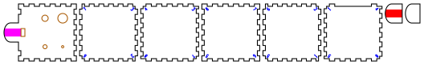
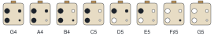

# Four-hole ocarinas

**[← All projects](https://gernreich.github.io/)**

<!-- readme-only -->
**[Read the writeup](https://gernreich.github.io/four-hole-ocarinas/)** ·
**[Turn all twelve builds in 3D](https://gernreich.github.io/four-hole-ocarinas/)**

<!-- page-only **[Read the README](https://github.com/Gernreich/four-hole-ocarinas)** · **[Turn it in 3D on a page of its own](turn.html)** -->

<!-- page-only <div id="turn3d"></div><script src="viewer.js"></script> -->

Four-hole ocarinas in 3 mm plywood, each a solid finger-jointed on every edge at
whatever angle its faces meet: four Platonic solids (the cube, the octahedron, the
dodecahedron and the icosahedron), two Archimedean ones (the truncated octahedron and
the cuboctahedron), two uniform prisms (hexagonal and octagonal), a square
antiprism, a zonohedron (the rhombic dodecahedron) and two Johnson solids (the
elongated square pyramid and bipyramid). Each has a beak to blow into, a
window, four finger holes and the English fingering, which gets a whole octave out
of four holes.

All twelve take the same window, holes and fingering, so every interval is the same;
only their cavities differ, and with them the key. Ten hold 279 to 283cm³ and play
near D4; the cuboctahedron, made a little bigger so its top takes the holes, holds
303cm³ and plays C♯4, and the octagon 354cm³ and C4. From the closed note the fingerings below give
the major scale up an octave, and three of the five notes between that the scale
leaves out.

Output is millimetre-true — `1 user unit = 1mm` with a physical `width`/`height` — so
it prints and cuts at real size.

**No build has been cut or played yet.** The cavity and the holes come from an
acoustic model whose window term is not measured, and the first one cut will set it.
[Before you cut](#before-you-cut) says what that means for the first build.

<table>
<tr>
<td align="center"><a href="cut-files/cube/four-hole-ocarina-cube-sheet1-cut-files.svg"></a></td>
</tr>
<tr>
<td align="center"><sub>cube · the whole ocarina on one 525 × 82 mm sheet</sub></td>
</tr>
</table>

Built for **[LaserMadeMusic](https://www.youtube.com/@LaserMadeMusic)**.

**[The rest of the build files](https://gernreich.github.io/lasermademusic.html)** — every instrument,
generator and tool, indexed.

**[Download everything as a ZIP](https://github.com/Gernreich/four-hole-ocarinas/archive/refs/heads/main.zip)**

## The builds

Twelve builds, every one a solid, each playing in whatever key its cavity holds.

| Build | Construction | Cavity | Key, all closed | Body | Parts | Sheets |
|---|---|---|---|---|---|---|
| `cube` | cube, finger-jointed on all 12 edges | 280cm³ | D4 −12 cents, 291.7Hz | 71.4 × 71.4 × 71.4 mm | 8 | 1 |
| `octagon` | uniform octagonal prism, finger-jointed on all 24 edges | 354cm³ | C4 −16 cents, 259.3Hz | 110 × 110 × 45.6 mm | 12 | 1 |
| `square-antiprism` | square antiprism, finger-jointed on all 16 edges | 279cm³ | D4 −7 cents, 292.4Hz | 101.8 × 101.8 × 60.5 mm | 12 | 1 |
| `octahedron` | regular octahedron, finger-jointed on all 12 edges | 281cm³ | D4 −14 cents, 291.2Hz | 105.7 × 91.5 × 74.7 mm | 10 | 1 |
| `dodecahedron` | regular dodecahedron, finger-jointed on all 30 edges | 283cm³ | D4 −21 cents, 290.1Hz | 99.1 × 94.2 × 80.2 mm | 14 | 1 |
| `truncated-octahedron` | truncated octahedron, finger-jointed on all 36 edges | 283cm³ | D4 −19 cents, 290.4Hz | 94.8 × 94.8 × 89.4 mm | 16 | 1 |
| `hexagonal-prism` | uniform hexagonal prism, finger-jointed on all 18 edges | 282cm³ | D4 −16 cents, 290.9Hz | 90.1 × 104.0 × 52.0 mm | 10 | 1 |
| `icosahedron` | regular icosahedron, finger-jointed on all 30 edges | 282cm³ | D4 −16 cents, 290.9Hz | 101.8 × 88.2 × 82.4 mm | 22 | 1 |
| `cuboctahedron` | cuboctahedron, finger-jointed on all 24 edges | 303cm³ | C♯4 +20 cents, 280.3Hz | 109.0 × 109.0 × 77.1 mm | 16 | 1 |
| `rhombic-dodecahedron` | rhombic dodecahedron, finger-jointed on all 24 edges | 279cm³ | D4 −9 cents, 292.1Hz | 91.6 × 97.2 × 79.4 mm | 14 | 1 |
| `elongated-square-pyramid` | elongated square pyramid (Johnson J8), finger-jointed on all 16 edges | 280cm³ | D4 −11 cents, 291.8Hz | 66.4 × 66.4 × 113.4 mm | 11 | 1 |
| `elongated-square-bipyramid` | elongated square bipyramid (Johnson J15), finger-jointed on all 20 edges | 280cm³ | D4 −11 cents, 291.8Hz | 123.4 × 62.6 × 87.3 mm | 14 | 1 |

The bird and the chin layer are glued, and the rest is press-fit.

The body is length × width × height, the prisms' length across their flats; the beak runs 18 mm
past it at the mouth end, the bird stands 3 mm on the top over it, and the chin layer
hangs 3 mm under it.

- **The cube** is six 71.4 mm squares, ten or eleven cells to an edge (a cell is one finger, the two plates taking turns), sized so that
  its cavity, 65.4 mm on a side, holds 280cm³, as the octahedron does. The top and
  bottom own the corners, and the window and the four holes are on the top. Under
  the beak the face below sends no fingers up into the top, so the beak runs on from
  solid ply and the duct crosses no seam; every build does the same. Until
  2026-10-18 the G4 build was a long box, 60 × 18 mm inside and as long as the volume
  needed, finger-jointed or glued up as a laminated stack. At the 14 × 7 mm window
  it ran 144 mm, 157 mm corner to corner inside against a quarter wavelength of 221 mm,
  close enough that it would start to act like a tube. So the box became a cube, at
  first sized to G4, then the same day to 280cm³; the stack went, and every build
  is a regular or uniform solid.
- **The octagon** is a uniform octagonal prism, 110 mm across the flats and as tall
  as a wall is wide, 45.6 mm: two regular octagons, top and bottom, and eight 45.6 mm
  squares. It was 36 mm tall until 2026-10-18, a prism but not a uniform one. It holds
  the most air, so it plays lowest, C4. The walls meet each other at 135 degrees
  with six cells to an edge, and the top and bottom at 90 with seven; the top and
  bottom own the corners. The holes and the window are in the top, the beak runs out
  from the middle of one wall's top edge, and that wall sends no fingers up into the
  top, as on the cube.
- **The square antiprism** is two 72 mm squares, top and bottom, a quarter turn apart,
  and eight equilateral triangles between them, 60.5 mm tall. Squares meet triangles
  at 103.8 degrees with eleven cells to an edge, and triangles meet each other at
  127.5 with twelve. The window and the holes are on the top square, on the cube's
  grid. The triangle under the beak slopes away beneath it, so it stops 3.1 mm short
  of the top there, clear of the beak's underside, and the chin layer is cut 1.5 mm
  shorter to clear the slope.
- **The octahedron** stands on one of its eight equilateral triangles, every edge
  91.5 mm, every joint at 109.5 degrees with fourteen or fifteen cells. The edge is
  sized for about 280cm³; it was 72 mm and 127cm³, a fifth higher, until 2026-10-18. Its top triangle
  is too small for four holes and the window, so it carries only the window, and
  each hand has a triangle of its own: the two that slope away from the top on
  either side, with the index finger's hole nearer the beak and both holes placed as
  far from the triangle's walls and from each other as they will go. The triangle
  under the beak stops 3.2 mm short there, and the chin layer is 2.1 mm shorter.
- **The dodecahedron** stands on one of its twelve regular pentagons, every edge
  36 mm, every joint at 116.6 degrees with five or six cells. The top pentagon
  carries the window, and each hole has a pentagon of its own, where it is furthest
  from that pentagon's walls: the index fingers on the two either side of the
  mouth's pentagon, the middle fingers on the next two round. The pentagon under the
  beak stops 3.4 mm short there, and the chin layer is 3.0 mm shorter.
- **The truncated octahedron** stands on one of its six squares, every edge 31.6 mm,
  with four or five cells to an edge. Squares meet hexagons at 125.3 degrees and
  hexagons meet each other at 109.5; three plates meet at every corner, so the
  corners close. The top square is too small for more than the window, so each hand
  has the hexagon on its side of it, both holes on the one face, the index finger's
  nearer the beak. The hexagon under the beak stops 3.7 mm short there, and the chin
  layer is 4.2 mm shorter.
- **The hexagonal prism** is uniform, as the octagon is: two regular hexagons and six
  52 mm squares, 90.1 mm across the flats and 52 mm tall. The walls meet each other at
  120 degrees with eight cells to an edge, and the top and bottom at 90 with seven.
  The window and the holes are in the top, on the cube's grid, and the beak runs out
  from the middle of one wall's top edge.
- **The icosahedron** stands on one of its twenty equilateral triangles, every edge
  54.5 mm, every joint at 138.2 degrees with eight or nine cells. Five plates meet
  at each corner. Its top triangle carries the window, and each hole has a triangle
  of its own, two on each side, the index finger's nearer the beak. The triangle
  under the beak stops 4.5 mm short there, and the chin layer is 6.7 mm shorter.
- **The cuboctahedron** stands on one of its six squares, every edge 54.5 mm, every
  joint at 125.3 degrees with eight or nine cells. Four plates meet at each corner,
  as on the antiprism and the octahedron. The window and the holes are on the top
  square, on the cube's grid. Near 280cm³, at a 53.5 mm edge, its top left 1.3 mm of
  ply between the biggest hole and a wall, under the 1.5 mm the generator asks for;
  at 54.5 mm and 303cm³ it leaves 2.3 mm, enough to file that hole up by the
  millimetre allowed. The triangle under the beak stops 3.7 mm short there, and the
  chin layer is 4.2 mm shorter.
- **The rhombic dodecahedron** is a zonohedron, the solid swept out by the cube's
  four body diagonals: twelve rhombi, every edge 48.6 mm, every joint at 120 degrees
  with seven or eight cells. It stands on a rhombus, which takes only the window, and
  each hand has the rhombus on its side of it, both holes on the one face, the index
  finger's nearer the beak, 22.6 mm apart. A rhombus can meet the beak with either
  pair of its edges; this one is turned so the hands' holes sit 67 mm apart and the
  furthest is 47 mm from the window, against 77 and 62 mm the other way round. Three
  or four plates meet at a corner. The rhombus under the beak stops 3.5 mm short
  there, and the chin layer is 3.5 mm shorter.
- **The elongated square pyramid** is Johnson solid J8: a 66.4 mm cube with a square
  pyramid of four equilateral triangles on its bottom, so it hangs point down from
  its square top. The window and the holes are on the top, on the cube's grid, and
  under the beak an upright wall, as on the cube. Walls meet the top at 90 degrees
  with eleven cells, the triangles meet the walls at 144.7 and each other at 109.5
  with ten or eleven. Four plates meet at the pyramid's point and at the four
  corners round its base.
- **The elongated square bipyramid** is Johnson solid J15: a 62.6 mm cube with a
  square pyramid on each end, four squares and eight equilateral triangles. It
  stands on a triangle, which takes only the window, and each hand has the triangle
  on its side of it, both holes on the one face, 20 mm apart: the nearest index and
  middle finger of any build, and the window 38 mm from the furthest hole, the
  nearest of all. Four plates meet at every corner. The square under the beak
  slopes away steeply, so it stops 5.2 mm short there, and the chin layer is 8.5 mm
  shorter, the most of any build: nearly half the 18 mm beak.

**How the solids' fingers go together.** Where two plates meet at an angle wider
than 90 degrees, a plate's finger reaches the outside edge, and in its neighbour's
finger it stops short by 3 mm × sin of the angle: 2.12 mm at 135 degrees, 2.83 mm at
109.5, 2.00 mm at the icosahedron's 138.2. That is the least that keeps the two plates out of each other, and it leaves
the joint closed along a line, with a shallow V-shaped notch outside each finger and
a small void at each corner. The shellac fills both.

**Where four or five plates meet.** At a corner of the square antiprism, the
octahedron, the cuboctahedron, the rhombic dodecahedron or the two Johnson solids
where four meet, two of the four plates share only the corner, and
no edge, and run into each other just inside it; on the icosahedron five meet, and
each shares only the corner with two. So every plate's corners there are cut off
square to the corner's bisector: 4.25 mm in from the corner on the antiprism, 4.75 mm
on the octahedron, 3.5 mm on the cuboctahedron, the icosahedron and the rhombic
dodecahedron, 4.5 mm on the elongated square bipyramid and 4.25 mm on the elongated
square pyramid, where the least that clears, found by scanning the corners in 3D,
was 3.75, 4.25, 3.0, 3.0, 3.0, 4.0 and 4.0 mm. The pyramid gets a quarter millimetre
over that, not a half: at 4.5 mm its joints stay open 6.1 mm from a corner, past the
two plate thicknesses the joint check allows. That leaves **a hole at every such corner**, open on the outside up to about
6 mm in from the point on the antiprism and the octahedron. Shellac will not bridge it: fill each with glue or wood filler before
sealing. On the cube, the two prisms, the dodecahedron and the truncated
octahedron, where three plates meet and every pair shares an edge, the corners
close on the outside.

Plates of one shape, the triangles of the antiprism, the octahedron, the icosahedron,
the cuboctahedron and the Johnson solids, the dodecahedron's pentagons, the rhombi,
and the squares and hexagons,
look alike but are not: each has its own pattern of fingers, set by which corners
are whose, so each goes in one place only. **Every corner of a solid has a number,
and every plate carries it near each of its own corners**: three numbers on a
triangle, four on a square or a rhombus, five on a pentagon, six on a hexagon. The plates that meet at a corner
all show its number, so the solid goes together by matching them. The 3D view
labels every plate's corners with them (the Corner numbers box turns them off);
pulled apart, it shows each plate with its own. The top plate is the one plate left
unnumbered: it carries half the duct on its outside face, so it is drawn outside
face up, and the beak, the window and the holes already place it. Every corner it
touches is numbered on the plates that meet it there. The corners are numbered from the top down,
1 at the top plate's corner beside the beak on the right hand's side. Each number is
engraved in single lines on the plate's inside face, where the finished ocarina hides it,
4 mm tall, its top toward its corner, and set in until it clears the joints, the
holes and the window by 1 mm.

**Against Boxes' polyhedra.** [Boxes](https://github.com/florianfesti/boxes) has
a Platonic generator, in its Unstable group, for the tetrahedron, cube, octahedron,
dodecahedron and icosahedron. It cuts every face the same, with one finger edge on
every side, its fingers shifted off-centre so that an edge mates with a copy of
itself turned end for end, and every finger a full plate thickness deep, as at 90
degrees, whatever angle the faces meet at. Here each edge is cut for its own angle,
each corner is given to one plate, and so the plates differ; in exchange the
fingers step back 3 mm × sin of the angle, the joints close on the outside, and the
corners are checked in 3D. Boxes does not make the prisms, the antiprism, the
two Archimedean solids, the rhombic dodecahedron or the Johnson solids.

None of the builds has anything to slide, so all are tuned at the window and the holes.

All twelve carry the same mouthpiece: the top plate runs on past the body as a beak 24 mm
wide. One layer, the bird, is glued over it and one, the chin layer, under it, so the
mouthpiece is three plies, 9 mm thick, with the duct near its middle. The duct is
14 mm wide, the window's width, and runs from the beak's tip to the window. Only the bird is needed for the sound; the chin layer gives the
lips a thicker mouthpiece and stiffens the beak. The tip, where the lips close, is a
half-ellipse across the beak's full 24 mm and 8 mm deep, cut the same on all three plies
so they round off as one, and the duct's mouth follows the curve.

**The duct is drawn as a savanna flue, in two colours, so you choose at the laser.**
The square flute names its flues for where they are carved: a **bird** flue in the
underside of the block, the woodland style; a **nest** flue in the body under it, the
plains style; and a **savanna** flue, half in each. Every sheet here carries both
halves, each in a colour of its own: **red** in the bird's underside and **magenta**
in the top plate's outside face, over the beak, the same 14mm-wide footprint lined up.

| Run | Flue | Depth |
|---|---|---|
| red only | bird | about 1 mm |
| magenta only | nest | about 1 mm |
| both | savanna | about 0.5 mm each |

The three put the airstream at different heights against the splitting edge: just
above the top plate's surface from a bird flue, just below it from a nest flue, and
level with it from a savanna flue, a shift of about one duct depth. The model does not
simulate the jet, so which voices best is for a test cut to show.

## Other solids

**Do zonohedra or Johnson solids reach the hands better?** `solid_survey` tried
23 more solids with equal edges, every one sized to the cube's 280cm³ and run through
the generator's own build and checks twice: once with the holes on the top's grid,
and once with each hand's holes on the faces at its side. Five were skipped before
building: a joint under 90 degrees, as on any pyramid on a triangle or on a cupola's
wide base, would put a finger out through the outside. Seven more fail, all with
many small faces: at 280cm³ the rhombic triacontahedron's edge is 30.5 mm and the
truncated cuboctahedron's 20.3 mm, too small for a hole and its ply, or for a corner
number. The rhombic icosahedron and the elongated square and pentagonal cupolas and
orthobicupolas fail too, on room for the holes, the corner numbers or, at the corner
cuts their corners need, joints left open too far from a corner. Eleven pass.

The hands' distances, hole centre to hole centre, are the measure: index to middle
finger, left index to right index, how far a hole's face tilts from the top, and the
window to the furthest hole.

| Build | Index–middle | Left–right | Tilt | Window–hole |
|---|---|---|---|---|
| the grid, on the cube and every build with its holes on top | 22 mm | 34 mm | 0° | 42 mm |
| `elongated-square-bipyramid` | 20 mm | 50 mm | 71° | 38 mm |
| `rhombic-dodecahedron` | 23 mm | 67 mm | 60° | 47 mm |
| `truncated-octahedron` | 27 mm | 64 mm | 55° | 46 mm |
| `icosahedron` | 29 mm | 48 mm | 71° | 47 mm |
| `octahedron` | 30 mm | 72 mm | 71° | 58 mm |
| `dodecahedron` | 42 mm | 68 mm | 63° | 56 mm |

**Nothing beats the grid.** Four holes on one flat top, 22 mm apart under each hand,
is the layout every build that can carry it already has, so a new solid improves on
it only by being another shape: the elongated square pyramid, a cube on a point,
plays and fingers exactly as the cube does. **Among the solids whose top is too small
for it,** the elongated square bipyramid and the rhombic dodecahedron reach best:
index and middle finger 20 and 23 mm apart against 27 to 42 mm on the four built, the
rhombic dodecahedron on the gentlest slope of any but the truncated octahedron. The
gyroelongated square pyramid, with its holes off the top, matches them at 22 mm but
puts the hands 74 mm apart on faces tilted 76°.

**The window does not move.** On every solid it sits at the top's beak edge, where
the duct meets it, so what a solid changes is how far the holes are from it and how
much the face under the beak cuts the chin layer back. The bipyramid has the window
nearest its holes, 38 mm, and pays for it under the beak: its square there slopes so
steeply that the chin layer loses 8.5 mm of the beak's 18.

Others that pass but were not built: the elongated and gyroelongated pentagonal
pyramids (holes on the top's grid, as the cube), the gyroelongated square pyramid,
the elongated pentagonal bipyramid, the elongated triangular cupola and
orthobicupola, and the triangular and square orthobicupolas, every one reaching
29 mm or more from index to middle finger with its holes off the top.

## Turn it in 3D

<!-- readme-only -->
All twelve builds turn in 3D at the top of the [published page](https://gernreich.github.io/four-hole-ocarinas/),
which GitHub does not run: drag to turn it, pull it apart into its parts, or see
through the walls into the cavity.

<!-- page-only The 3D view is at [the top of this page](#four-hole-ocarinas). It also opens [on a page of its own](turn.html). -->

## Fingering

The model works the scale out in G, from G4, and the chart and tables give its
figures there; every build plays the same steps from its own closed note. Black is
covered, white is open. The chart shows the holes as your hands meet them:
beak up, left hand on the left, index fingers on the row nearer the beak.



Hold it with the holes facing away from you and your lips on the beak, thumbs on the
bottom. Each hole is named for the finger that covers it: `L1` is the left index,
`L2` the left middle, `R1` the right index, `R2` the right middle.

| Note | Open | Model | From equal temperament |
|---|---|---|---|
| G4 | none | 392.0Hz | 0 |
| A4 | R2 | 441.6Hz | +6.2c |
| B4 | R1 | 488.4Hz | −19.2c |
| C5 | R2 R1 | 529.1Hz | +19.2c |
| D5 | R2 L2 | 592.6Hz | +15.4c |
| E5 | R2 R1 L2 | 660.4Hz | +2.9c |
| F♯5 | R1 L1 L2 | 748.2Hz | +19.2c |
| G5 | all four | 775.4Hz | −19.2c |

The right hand alone plays G4 to C5. Above that the left hand comes in, its middle
finger first: D5 opens R2 and L2, E5 adds R1, F♯5 opens R1 and the whole left hand,
and G5 opens every hole. The other eight fingerings are not in the scale, and
three of them give the notes it lacks closely enough to use: C♯5, D♯5 and F5.

| Open | Model | Nearest | |
|---|---|---|---|
| L2 | 556.6Hz | C♯5 | +7.0c |
| L1 | 564.6Hz | C♯5 | +31.6c |
| R2 L1 | 600.1Hz | D5 | +37.2c |
| R1 L2 | 628.3Hz | D♯5 | +16.7c |
| R1 L1 | 635.4Hz | D♯5 | +36.1c |
| R2 R1 L1 | 667.1Hz | E5 | +20.5c |
| L1 L2 | 689.2Hz | F5 | −23.2c |
| R2 L1 L2 | 718.5Hz | F5 | +49.0c |

A hole's pitch rises by the same ratio whatever cavity it opens, so each build plays
this major scale and these cents from its own closed note: D4 −12 cents on the cube,
C4 −16 on the octagon, D4 −7 on the square antiprism, D4 −14 on the octahedron and
D4 −21 on the dodecahedron, D4 −19 on the truncated octahedron, D4 −16 on the
hexagonal prism and the icosahedron, and C♯4 +20 on the cuboctahedron.

## What the model says

**An ocarina is a vessel, not a tube.** The cube's cavity is 113 mm corner to corner and
the wavelength at its D4 is 1187 mm, so the air inside acts as one spring and the air in each
opening as a mass on it: a Helmholtz resonator. The pitch depends on the cavity's
volume and on how much air each opening lets through, its conductance, and **not at
all on where a hole is**. That is why the holes sit wherever the fingers fall.

Each opening's conductance is its area over its effective length: the 3 mm plate it
goes through, plus Rayleigh's end correction for a flanged end, once inside and once
out. Open holes add to the window's in parallel, so every note asks for a sum:

| Hole | Finger | Conductance | Diameter |
|---|---|---|---|
| `R2` | right middle | 0.269 × the window's | 4.20 mm |
| `R1` | right index | 0.553 × | 7.04 mm |
| `L1` | left index | 1.074 × | 11.84 mm |
| `L2` | left middle | 1.016 × | 11.32 mm |

The window is 14 × 7 mm, with a conductance of 7.85 mm. G4 from that window would ask
for a cavity of 155.1cm³; the builds hold 1.8 to 2.3 times that, and play lower.

**The window is as big as the holes allow.** The top note, an octave over the closed
one, needs the open holes to pass three times the window's conductance, so the holes
grow with the window. At 14 × 7 mm the biggest hole is 11.8 mm, a millimetre under the
12 mm that leaves room to file it up before it outgrows the 13 mm a fingertip covers.
Big ocarinas are given big windows: a low note through a small window asks for a slow,
weak jet. Every build shares this one, so every build shares the holes. It was 10 ×
5 mm until 2026-10-18, with a cavity of 101cm³, and the tightest fingering, below, kept it there.

**No four holes play a perfect scale.** Two holes opened together always add their
conductances, and the scale's steps do not add that way. Here C5 opens the A4 hole and
the B4 hole together, and the two give more than C5 wants. So the model shares the
error out: B4 and G5 sit 19.2 cents flat, C5 and F♯5 19.2 sharp, D5 15.4 sharp, and A4
and E5 within 7. Breath bends an ocarina by that much: blow a little harder for B4
and G5, a little softer for C5, D5 and F♯5.

**The fingering is found, not copied, and it is not the tightest.** John Taylor's
English system of 1964 is the standard four-hole fingering, and no published source
found for this gives its hole sizes, so the pattern comes from a search over all four
conductances. Of the 53 patterns `ocarina_model --search` finds, the tightest holds
every note within 12.3 cents, and it was the fingering here until 2026-10-18. It needs
one hole 1.72 times the window's conductance, though, and that caps the window: at the
14 × 7 mm one the bigger solids want, that hole would be 17 mm, past a fingertip. This
pattern opens all four holes for the top note, which shares the conductance out, so
its biggest hole is 1.07 times the window's. It starts the scale as the tightest one
does, ends with every hole open, and takes ten finger moves up the scale to its eleven.
It costs 7 cents of tuning. It may not match a commercial English pendant's chart note
for note.

## Before you cut

**The window's end correction is not measured.** The jet blowing across the window
lengthens it, by an amount found only in simulation so far: a 2009 simulation of an
ocarina ([Kobayashi and others](https://arxiv.org/abs/0911.3567)) put it well above
the textbook figure. It is the one term every other number rests on: the cavity is
sized to the window, and every hole is sized against it. With every hole closed,
blow the cut ocarina and read its pitch. Then

```sh
target/release/ocarina_model --heard=290 --cavity=280   # the pitch you heard, in Hz, and the build's cavity in cm³
```

prints the `--mouth` that explains it, and the command to redraw every build with
it. The cavity is the one in the table of builds, or as the generator prints it;
any build's closed note will do, since the window is the same on all twelve. A first build that sounds 50 cents flat is not a failure; it is the measurement.

**Cut the cube first.** It is the simplest, every joint at 90 degrees, and its
closed note measures the window as well as any. All twelve are a step from anything
measured: their 14 × 7 mm window is sized to the holes, and the cavities it speaks
into play a fourth or a fifth below the G4 it would suit. Whether it is big enough
for them to speak strongly is for a test to show.

**The holes can only go up.** A hole that plays flat can be opened with a file. A hole
that plays sharp cannot be closed up, so file in small steps.

**File the splitting edge by hand.** The window's far edge, the one away from the
beak, is where the air splits, and it needs a clean bevel of about 30° that a laser
cannot cut. File it on the outside face, the face the bird sits on, while the top is
still a flat plate on the bench. **A blue line across the top marks where to file
to**: 5.2 mm past the window, where a 30° bevel through the 3 mm plate meets the
outside face. File from the window's edge back to the line, keeping the edge
itself sharp at the inside face.

**The duct is a fill engrave**, the window's 14 mm width, about 1 mm deep in one colour
or 0.5 mm in each of two (see the mouthpiece, under [The builds](#the-builds)). The depth
is a power setting, so find it on scrap first, and run the engraves before the cuts,
while the parts still lie where they were drawn.

**The smallest hole is 4.2 mm.** At the kerf it is the one most likely to come out
ragged or choked with char. Clear it with a 4 mm drill held in the fingers, which
takes off the char and nothing more.

**Cut it in 3 mm Baltic birch plywood**, at a 0.13 mm kerf. The fingers are the square
flute's size or a little over: each edge is split into equal cells, 6.00 to 7.59 mm
wide, with no play, so the fit comes from the kerf compensation alone. **If your laser's
kerf is not 0.13 mm, redraw the sheets for its own** with `--kerf=`: a press-fit that
comes out loose wants a wider kerf, one too tight to close a narrower one. Each
0.05 mm more makes every finger 0.05 mm tighter against each side of its slot: the
finger is drawn 0.05 mm wider and the slot 0.05 mm narrower. Glue the bird on the top and the chin layer under the
beak. Press-fit the rest, then seal every seam with shellac, inside where you can reach and outside
everywhere: a Helmholtz resonator leaks its note out of any gap.

Run the engraves first, then the cuts. **Red** and **magenta** engrave the duct,
filled: red the bird's half, magenta the nest's, either or both. **Blue** engraves
single lines: the bevel guide on the top and the corner numbers on every other plate. Then **orange** cuts the window and the holes, and
**black** frees the parts. Red and magenta are
outside the house order, whose one engrave colour is blue: the two halves need a
colour each so that either can be left off. The plates are drawn inside face up, so
the numbers land on the inside, except the top, drawn outside face up for its half
of the duct and the bevel guide.

## Tuning

1. File the splitting edge back to the blue line, then glue the bird on, its end flush with the window's
   near edge so the duct opens straight on to it, and the chin layer under the beak,
   its end against the body.
2. Press the solid together by its corner numbers, every plate to the corners that
   carry its numbers; fill the open corners of the square antiprism, the octahedron,
   the cuboctahedron, the icosahedron, the rhombic dodecahedron and the two Johnson
   solids with glue or wood filler. Then seal every
   seam with shellac, so that the notes you tune to are the sealed ocarina's: a
   leak passes air like one more small hole and raises the pitch.
3. With every hole closed, play the closed note, the one in the table of builds. If
   it is out by more than breath will bend, run `--heard` with the build's cavity
   and note the `--mouth` for the next cut.
4. Open each hole alone, smallest first, and file it up to the model's pitch for
   it. On the cube `R2` alone is 328.6Hz, `R1` 363.5Hz, `L2` 414.2Hz and `L1`
   420.2Hz; the scale's other notes are sums of these four and follow from them. On
   the octagon they are 292.1, 323.0, 368.1 and 373.4Hz; on the square antiprism
   329.4, 364.4, 415.2 and 421.2Hz; on the octahedron 328.1, 362.9, 413.5 and
   419.5Hz; on the dodecahedron 326.8, 361.5, 411.9 and 417.8Hz; on the truncated octahedron
   327.1, 361.8, 412.3 and 418.2Hz; on the hexagonal prism and the icosahedron
   327.7, 362.5, 413.1 and 419.0Hz; on the cuboctahedron 315.8, 349.3, 398.1 and
   403.8Hz; on the rhombic dodecahedron 329.1, 364.0, 414.8 and 420.8Hz; on the
   two Johnson solids 328.7, 363.6, 414.3 and 420.3Hz. Tune any of them
   from whatever its closed note turns out to be:
   each hole alone sounds 1.127, 1.246, 1.420 and 1.440 times it.
5. Once it plays in tune, shellac the filed holes and the splitting edge.

## Regenerating it

```sh
cargo build --release                                     # once, and after any change
target/release/ocarina_model                              # the design and all sixteen fingerings
target/release/ocarina_model --mouth=1.2                  # with a different window correction
target/release/ocarina_model --heard=290 --cavity=280     # the correction a cut ocarina implies
target/release/ocarina_model --search                     # the fingering patterns, ranked
target/release/four_hole_ocarinas --no-write              # the generator's checks, writing nothing
target/release/four_hole_ocarinas --out=cut-files         # all twelve builds
target/release/four_hole_ocarinas --kerf=0.18 --out=mine  # for a laser with a 0.18mm kerf
target/release/page_assets                                # viewer.js, turn.html and the two plans
target/release/solid_survey                               # other solids, and how each reaches the hands
```

The programs are Rust since 2026-11-07, Python until then; the move changed no byte of
any cut file, plan or page, and the survey's report came out the same, in a second
instead of ten minutes.

`ocarina_model.rs` is the Helmholtz model above. For a fingering pattern it finds the
four conductances by a pattern search that minimises the worst note's error in cents.
`--search` asks which pattern, from 400 random starts: it found 53 that give eight
different fingerings. The tightest heads the list, at 12.3 cents and 11 finger moves
up the scale; the one used here is at 19.2 cents and 10 moves, chosen for its holes.

`four_hole_ocarinas.rs` builds all twelve with what the model asks for and checks them
before writing anything. The solids are built by `polyhedron.rs`, which takes any
convex solid as its faces' planes and joints every edge at its own angle. It checks:

- the model holds the scale within 20 cents
- the cube's cavity is the 280cm³ asked for
- the cavity is small against a quarter wavelength, so it rings as one chamber:
  141 mm corner to corner at most, in the elongated square bipyramid, against 296 mm
  or more
- every hole speaks and a finger covers it: from 2.5 to 13 mm across
- every hole and the window open into the cavity, and ply is left between the holes
  and between the holes and the window
- each hand's holes lie under that hand, worked out from the geometry
- the duct runs from the beak's tip to the window, its two halves lined up in the
  bird and the top, and the top carries no numbers
- the bevel guide sits where a 30° bevel meets the outside face, 5.2 mm past the
  window, over the cavity and clear of the holes
- every edge is finger-jointed with as many 6 mm cells as fit
- along every joint, no point lies in two plates: from 1152 points on the cube
  to 2313 on the icosahedron, through each finger from the outside edge to the
  inner corner
- every joint closes except within a finger of a corner, where the shellac goes
- round every corner, a 3D grid through the walls finds no point in two plates:
  this is what catches plates that share only a corner
- the beak, the bird and the chin layer run into no other part
- every plate but the top numbers each of its corners on its inside, clear of the
  joints, the holes and the window, and every corner's number is on at least two of
  the plates that meet there
- every sheet fits the bed, and every part is on a sheet

The joint checks were proved by breaking them: with no step back every sampled point
lies in two plates, and with three times the step the joints open. Without the
corner cuts the corner scan finds 229 points in two plates on the square antiprism,
93 on the octahedron, 1401 on the cuboctahedron, 361 on the icosahedron, 420 on the
rhombic dodecahedron, 43 on the elongated square pyramid and 46 on the bipyramid.

The crate borrows the finger size, the kerf and the sheet packer from the square flute's
[`square_flute.rs`](https://github.com/Gernreich/square-flute/blob/main/square_flute.rs),
with the viewer's page from its `page_assets.rs`, and the SVG path writer from
[`ribbon_bore.rs`](https://github.com/Gernreich/swept-curve/blob/main/ribbon_bore.rs)
in swept-curve, so it expects
[square-flute](https://github.com/Gernreich/square-flute),
[swept-curve](https://github.com/Gernreich/swept-curve),
[bore-tmm](https://github.com/Gernreich/bore-tmm) (which the square flute's crate needs) and
[lasermade-tools](https://github.com/Gernreich/lasermade-tools) cloned beside this one.

`.repro` holds the exact command for every generated file here.

The cube's top plate, from outside and to scale, beak on the left:


## Every cut sheet

Each picture is a display rendering; click it for the cut file.

**`cube`** · cube, finger-jointed on all 12 edges, cavity 280cm³ · 8 parts on 1 sheet

[](cut-files/cube/four-hole-ocarina-cube-sheet1-cut-files.svg)

**`octagon`** · uniform octagonal prism, finger-jointed on all 24 edges, cavity 354cm³ · 12 parts on 1 sheet

[](cut-files/octagon/four-hole-ocarina-octagon-sheet1-cut-files.svg)

**`square-antiprism`** · square antiprism, finger-jointed on all 16 edges, cavity 279cm³ · 12 parts on 1 sheet

[](cut-files/square-antiprism/four-hole-ocarina-square-antiprism-sheet1-cut-files.svg)

**`octahedron`** · regular octahedron, finger-jointed on all 12 edges, cavity 281cm³ · 10 parts on 1 sheet

[](cut-files/octahedron/four-hole-ocarina-octahedron-sheet1-cut-files.svg)

**`dodecahedron`** · regular dodecahedron, finger-jointed on all 30 edges, cavity 283cm³ · 14 parts on 1 sheet

[](cut-files/dodecahedron/four-hole-ocarina-dodecahedron-sheet1-cut-files.svg)

**`truncated-octahedron`** · truncated octahedron, finger-jointed on all 36 edges, cavity 283cm³ · 16 parts on 1 sheet

[](cut-files/truncated-octahedron/four-hole-ocarina-truncated-octahedron-sheet1-cut-files.svg)

**`hexagonal-prism`** · uniform hexagonal prism, finger-jointed on all 18 edges, cavity 282cm³ · 10 parts on 1 sheet

[](cut-files/hexagonal-prism/four-hole-ocarina-hexagonal-prism-sheet1-cut-files.svg)

**`icosahedron`** · regular icosahedron, finger-jointed on all 30 edges, cavity 282cm³ · 22 parts on 1 sheet

[](cut-files/icosahedron/four-hole-ocarina-icosahedron-sheet1-cut-files.svg)

**`cuboctahedron`** · cuboctahedron, finger-jointed on all 24 edges, cavity 303cm³ · 16 parts on 1 sheet

[](cut-files/cuboctahedron/four-hole-ocarina-cuboctahedron-sheet1-cut-files.svg)

**`rhombic-dodecahedron`** · rhombic dodecahedron, finger-jointed on all 24 edges, cavity 279cm³ · 14 parts on 1 sheet

[](cut-files/rhombic-dodecahedron/four-hole-ocarina-rhombic-dodecahedron-sheet1-cut-files.svg)

**`elongated-square-pyramid`** · elongated square pyramid (Johnson J8), finger-jointed on all 16 edges, cavity 280cm³ · 11 parts on 1 sheet

[](cut-files/elongated-square-pyramid/four-hole-ocarina-elongated-square-pyramid-sheet1-cut-files.svg)

**`elongated-square-bipyramid`** · elongated square bipyramid (Johnson J15), finger-jointed on all 20 edges, cavity 280cm³ · 14 parts on 1 sheet

[](cut-files/elongated-square-bipyramid/four-hole-ocarina-elongated-square-bipyramid-sheet1-cut-files.svg)

## Files

| | |
|---|---|
| `cut-files/cube/four-hole-ocarina-cube-sheet1-cut-files.svg` | the cube |
| `cut-files/octagon/four-hole-ocarina-octagon-sheet1-cut-files.svg` | the octagonal prism |
| `cut-files/square-antiprism/four-hole-ocarina-square-antiprism-sheet1-cut-files.svg` | the square antiprism |
| `cut-files/octahedron/four-hole-ocarina-octahedron-sheet1-cut-files.svg` | the octahedron |
| `cut-files/dodecahedron/four-hole-ocarina-dodecahedron-sheet1-cut-files.svg` | the dodecahedron |
| `cut-files/truncated-octahedron/four-hole-ocarina-truncated-octahedron-sheet1-cut-files.svg` | the truncated octahedron |
| `cut-files/hexagonal-prism/four-hole-ocarina-hexagonal-prism-sheet1-cut-files.svg` | the hexagonal prism |
| `cut-files/icosahedron/four-hole-ocarina-icosahedron-sheet1-cut-files.svg` | the icosahedron |
| `cut-files/cuboctahedron/four-hole-ocarina-cuboctahedron-sheet1-cut-files.svg` | the cuboctahedron |
| `cut-files/rhombic-dodecahedron/four-hole-ocarina-rhombic-dodecahedron-sheet1-cut-files.svg` | the rhombic dodecahedron |
| `cut-files/elongated-square-pyramid/four-hole-ocarina-elongated-square-pyramid-sheet1-cut-files.svg` | the elongated square pyramid |
| `cut-files/elongated-square-bipyramid/four-hole-ocarina-elongated-square-bipyramid-sheet1-cut-files.svg` | the elongated square bipyramid |
| `previews/` | display renderings of every sheet — **not** cut files |
| `plans/four-hole-ocarina-top-plate.svg` · `plans/four-hole-ocarina-fingering.svg` | the cube's top plate to scale, and the fingering chart — display drawings, **not** cut files |
| `viewer.js` | the 3D view of every build, loaded by the published page |
| `turn.html` | the same 3D view on a page of its own, for framing elsewhere |
| `ocarina_model.rs` | the acoustic model |
| `four_hole_ocarinas.rs` | the generator, its checks and every cut file; the mitred offset that the octagonal flute, the panpipes and the chanters borrow |
| `polyhedron.rs` | the solids, and their joints at any angle, which the octagonal flute and the panpipes' tube sets borrow |
| `solidcraft.rs` · `solidcraft/` | every build as a parametric SolidCraft design, and the cube's cavity check |
| `solid_survey.rs` | other solids tried against the generator's checks, and how each reaches the hands |
| `page_assets.rs` | builds `viewer.js`, `turn.html` and the plans |
| `bin/` · `Cargo.toml` · `Cargo.lock` | the crate: one small file per program, and the pinned build |
| `README.md` · `index.html` | this writeup and its published page; the markdown is the source |
| `.repro` | the command that draws each generated file |

Released under [CC0 1.0](LICENSE).

## STEP files

`step/` holds every build as a STEP file, to open or import in a CAD program such
as SolidCraft, Fusion or FreeCAD: one solid body per part, in millimetres,
assembled as the 3D view shows it, the holes true cylinders and the duct and bevel
cut. SolidCraft writes each from the build's parametric design (see
[SolidCraft design](#solidcraft-design)), and `.repro` checks them:

```
target/release/four_hole_ocarinas --only=octagon --no-write --solidcraft=solidcraft
solidcraft-cli run solidcraft/four-hole-ocarina-octagon.solidcraft.json --out step/four-hole-ocarinas-octagon.step
```

The files:

- `step/four-hole-ocarinas-cube.step`
- `step/four-hole-ocarinas-cuboctahedron.step`
- `step/four-hole-ocarinas-dodecahedron.step`
- `step/four-hole-ocarinas-elongated-square-bipyramid.step`
- `step/four-hole-ocarinas-elongated-square-pyramid.step`
- `step/four-hole-ocarinas-hexagonal-prism.step`
- `step/four-hole-ocarinas-icosahedron.step`
- `step/four-hole-ocarinas-octagon.step`
- `step/four-hole-ocarinas-octahedron.step`
- `step/four-hole-ocarinas-rhombic-dodecahedron.step`
- `step/four-hole-ocarinas-square-antiprism.step`
- `step/four-hole-ocarinas-truncated-octahedron.step`

## SolidCraft design

The generator also writes every build as a parametric SolidCraft design, in
`solidcraft/`. Every rule the generator follows is an expression in it, so changing
one number rebuilds the rest: type a note and the ocarina resizes to sound it, its
joints re-counted and its holes re-sized.

The designs, each built with `solidcraft-cli run FILE --save NAME.sc` and the `.sc` opened in SolidCraft:

- `solidcraft/four-hole-ocarina-cube.solidcraft.json`
- `solidcraft/four-hole-ocarina-cuboctahedron.solidcraft.json`
- `solidcraft/four-hole-ocarina-dodecahedron.solidcraft.json`
- `solidcraft/four-hole-ocarina-elongated-square-bipyramid.solidcraft.json`
- `solidcraft/four-hole-ocarina-elongated-square-pyramid.solidcraft.json`
- `solidcraft/four-hole-ocarina-hexagonal-prism.solidcraft.json`
- `solidcraft/four-hole-ocarina-icosahedron.solidcraft.json`
- `solidcraft/four-hole-ocarina-octagon.solidcraft.json`
- `solidcraft/four-hole-ocarina-octahedron.solidcraft.json`
- `solidcraft/four-hole-ocarina-rhombic-dodecahedron.solidcraft.json`
- `solidcraft/four-hole-ocarina-square-antiprism.solidcraft.json`
- `solidcraft/four-hole-ocarina-truncated-octahedron.solidcraft.json`
- `solidcraft/four-hole-ocarina-cube.cavity.json`, the cube's cavity check

### The cube

| Parameter | Default | What it is |
|---|---|---|
| `key_hz` | 291.71 | the note with every hole closed; by default what the 280 cm³ cube sounds (D4, 11.5 cents flat). Type a frequency to resize |
| `L` · `W` · `H` | the cube for `key_hz` | outside, mouth face to back, across, bottom to top; give `W` or `H` a value of its own for a box |
| `ply` | 3 mm | sheet thickness; the holes and the window's end correction follow it |
| `finger` | 6 mm | the shortest cell along an edge |
| `window_w` · `window_l` | 14 · 7 mm | the window; the holes follow it |
| `mouth` · `temp_c` · `a4` | 1 · 25 · 440 | the window's end-correction scale (`--mouth`), the breath's temperature, concert pitch |
| `ratio_R2` … `ratio_L2` | from the model | each hole's conductance over the window's: the fingering search's result |
| `beak` · `beak_w` · `tip` | 18 · 24 · 8 mm | the beak's length, width and tip rounding |
| `duct_depth` · `bevel` | 0.5 mm · 30° | each half of the duct, engraved in the top and the bird; the window's filed far edge |
| `row_1` · `row_2` · `columns` | 20 · 42 · 34 mm | where the holes sit, from the mouth wall |

Read-only parameters show the result: `d_R2` … `d_L2` (the holes), `cavity_mm3`,
`pitch_hz` and `semitones_a4` (what the box sounds), `cellsX`, `cellsY`, `cellsZ`
and `keep` (the joints), and `room_far` and `room_side`, the room left past the
holes to the back and side walls. Below 0 the holes run into a wall: from about
B4 up the cube is too small for the hand.

### The other eleven

Each is sized by one measure, `edge`, or `flats` for the octagon, which `key_hz`
sets as it sets the cube's edge. Every point of the solid scales with it. They take
the cube's parameters but `L`, `W`, `H`, `row_1`/`row_2`/`columns` where the holes
are on side faces, and the cube's joint read-outs, and add:

- `nip`: where more than three plates meet, each corner cut back this far, square
  to its bisector.
- `s`: the scale against the generator's build.
- `room`: the least web from a hole to a wall's inside face, or half the web between
  two holes on one face. Below 0 the build is too small for the hand.

The plates are the face polygons extruded `ply` inward. Along each edge the cells
alternate between its two plates, as many as fit with none under `finger`, odd or
even as the corners' owners ask, and each plate loses its neighbour's cells as a
strip `ply` × sin(the joint's angle) deep. Where an end cell is the neighbour's,
the strip runs on past the corner. Where the parity of the count decides which
plate owns an end, an expression decides whether that cut is made.

The holes on a side face sit where the generator's search puts them: as far as
they can be from every wall of the face's inside, or, for two on one face, with the
narrowest web as wide as it can be. Each is a small linear programme, solved
exactly, so the hole's place is a linear expression in the size, `ply` and the
holes' diameters. On the rhombic dodecahedron the best place for a pair is a run of
points, not one. The design keeps the point as far along the run as the generator's
search stopped, so the default build is the cut file's.

The cavity is a cubic in the scale and `ply`, fitted exactly to the generator's
inside, and `key_hz` sets the scale by four Newton steps; `pitch_hz` reads it back.

**The tune** is ocarina_model.rs's, in closed form. The window's conductance is
its area over `ply` plus its end correction. Each hole's conductance is its ratio
times the window's, and its diameter solves π d²/4 = k (`ply` + 0.849 d). The
closed note is c/2π √(k_w / V). The holes follow the window and `ply`, not the
size: the scale is ratios of the window, so a bigger cube with the same holes plays
the same scale lower. At the defaults the design gives the generator's four holes
and its 291.7 Hz.

**The joints** follow the generator's rules. Each edge has as many cells as fit
with none under `finger`. An edge of the top or the bottom has an odd count, since
that plate owns both its ends. An upright edge has an even count. Under the beak
the top keeps every cell of its mouth edge. When the cube is narrow enough to leave
the mouth side no cell beside the beak (`keep` = 0), the top takes the whole edge.

**Checked**, the cube against the generator's own parts, body by body, at six sizes: the
default cube, a 90 mm cube, 100 × 80 × 66 mm, 120 × 75 × 50 mm, 52 mm, and
100 × 52 × 60 mm, where `keep` = 0. Every wall, the bottom and the chin layer
matched within 0.001 mm. The top and the bird differ by the duct and the bevel,
which the generator only engraves: 143.6 mm³ for each half of the duct and
109.1 mm³ for the bevel. At 52 mm the far holes run into the back wall, as
`room_far` says. Driven by `key_hz` from C4 to C5, the design rebuilds with no two
plates overlapping, and `pitch_hz` reads back the note asked for.

The other eleven were checked the same way at their own size and at two others
each (0.8 and 1.25 times, or 0.85 and 1.2 where the holes are on side faces).
Every plate matched within 0.005 mm, but for these differences:

- The top and the bird differ by the duct and the bevel, as on the cube.
- At 0.8 times the cuboctahedron's and the elongated square pyramid's holes run
  off the top or into a wall, where `room` reads below 0. The design still
  rebuilds; the cut file at that size would fail the generator's own checks.
- On the rhombic dodecahedron the generator's corner clip, where the beak meets a
  nipped corner, keeps 3.6 mm³ of the top that the nip rule cuts. Neither version
  has two plates overlapping. At other sizes the generator's search stops at a
  different point along the pair's run, so one plate's holes sit elsewhere on
  equally good ground.

Driven by `key_hz` to C4 and F4, the octagon, icosahedron, dodecahedron and rhombic
dodecahedron rebuild with no two plates overlapping, and `pitch_hz` reads back the
note asked for. At their defaults each design's pitch is the generator's.

Left out: the corner numbers, single engraved lines.

```
target/release/four_hole_ocarinas --only=cube --no-write --solidcraft=solidcraft
solidcraft-cli run solidcraft/four-hole-ocarina-cube.solidcraft.json --save cube.sc
solidcraft-cli run solidcraft/four-hole-ocarina-cube.cavity.json --in cube.sc --results
```

The `.sc` design is not shipped: SolidCraft writes it differently each time, so
`.repro` checks the script and the STEP file built from it instead. The cavity
check boxes the cube's outside, cuts every face plate from it and measures what is
left: 281.21 cm³. Less the four holes' and the window's plugs through the top
(1.08 cm³), the bevel (0.11 cm³) and the duct over the mouth wall (0.02 cm³), that
is the 280.00 cm³ the generator builds. SolidCraft's interference check finds no
two plates overlapping.

## Credits

Made by Michael Gernreich with [Claude](https://www.anthropic.com/claude) (Anthropic), working in Claude Code, which co-wrote the code and the documentation. Commits Claude made carry a `Co-Authored-By: Claude` line.
